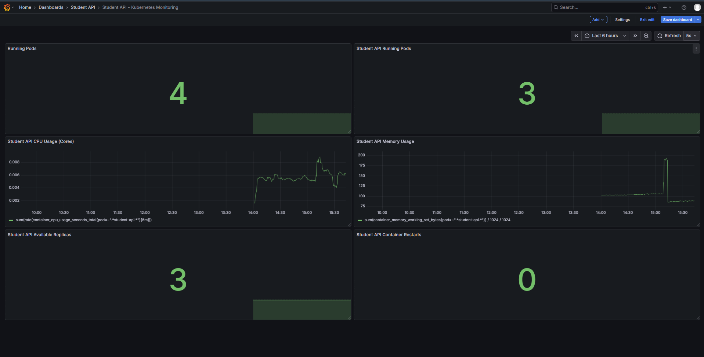

# Kubernetes Monitoring with Prometheus and Grafana

## Project Overview

This is a hands-on DevOps learning project focused on monitoring a Kubernetes application using Prometheus and Grafana.

The project uses a Student API deployed on a local Kubernetes cluster to practise monitoring application health, resource usage, and deployment availability.

## Grafana Dashboard Preview



## Tools and Technologies

- Kubernetes
- Docker Desktop
- Prometheus
- Grafana
- Helm
- kubectl
- PromQL
- Git and GitHub

## Monitoring Features

- Kubernetes pod monitoring
- Student API replica availability
- CPU usage monitoring
- Memory usage monitoring
- Container restart monitoring
- Grafana alert rule for replica availability

## Learning Objectives

- Understand how Prometheus collects and queries metrics.
- Create Grafana dashboards using Prometheus as a data source.
- Write basic PromQL queries.
- Monitor Kubernetes deployments and pods.
- Configure a Grafana alert rule.
- Document a DevOps monitoring setup.

## Project Structure

```text
kubernetes-monitoring-prometheus-grafana/
├── README.md
├── docs/
│   ├── architecture.md
│   ├── setup-guide.md
│   ├── promql-queries.md
│   └── screenshots/
│       └── grafana-dashboard.png
└── k8s/
    └── monitoring/
```

## Architecture

The project uses the following monitoring workflow:

1. The Student API runs inside Kubernetes pods.
2. Prometheus collects available metrics.
3. PromQL queries retrieve and calculate metric values.
4. Grafana visualizes the metrics in dashboards.
5. Grafana alert rules evaluate configured monitoring conditions.

See [Architecture Documentation](docs/architecture.md) for more details.

## Documentation

- [Architecture](docs/architecture.md)
- [Setup Guide](docs/setup-guide.md)
- [PromQL Queries](docs/promql-queries.md)

## Environment

This project was practised locally using Docker Desktop Kubernetes.

## Project Status

In progress — monitoring documentation, dashboard configuration, and project improvements are being developed.

## Author

**Pathum Nimsara**

GitHub: [@pathumnimsara](https://github.com/pathumnimsara)

## Disclaimer

This is a learning project designed for a local development environment. Additional configuration, security measures, and testing are required before using a similar setup in production.
